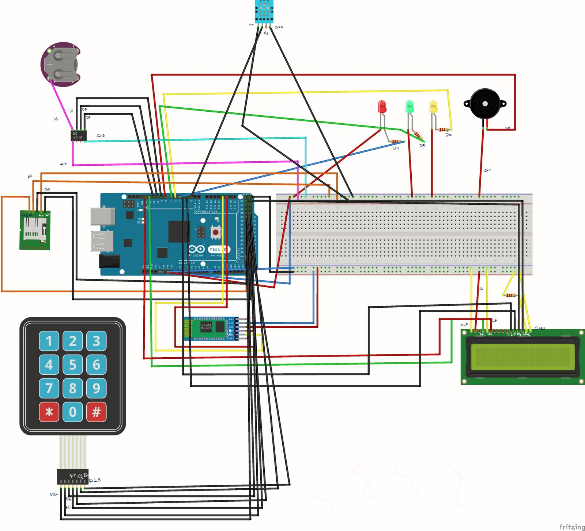

# Greenhouse Monitoring System

Arduino Mega-based greenhouse temperature monitoring and logging system (2024).

## Features
- Temperature measurement with DHT11 sensor
- Real-time clock (DS1302) for timestamping
- 16x2 I2C LCD showing date, time and temperature
- Adjustable lower/upper temperature thresholds via 3x4 keypad (defaults: 25°C / 30°C)
- Three-level warning: green / yellow / red LED, with buzzer above the upper threshold
- Data transfer to Android phone via HC-05 Bluetooth module
- Data logging to SD card in CSV format (exportable to Excel)

## Hardware
Arduino Mega 2560, DHT11, DS1302 RTC, HC-05, SD card module, 16x2 I2C LCD, 3x4 keypad, LEDs, buzzer

## Software
C/C++ (Arduino IDE). Libraries: DHT, DS1302, LiquidCrystal_I2C, SD, Keypad
